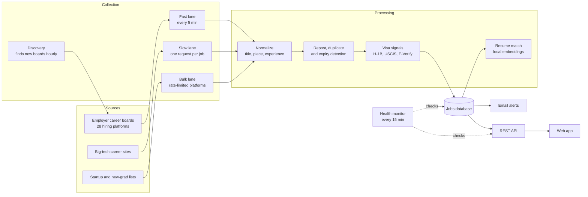

# FreshJobs

**Apply first. Get seen first.** A job portal for international students in the US that finds new roles minutes after employers post them, and shows the visa facts that decide whether a job is worth applying to.

**Live:** [freshjobs-prathu.duckdns.org](https://freshjobs-prathu.duckdns.org) (free; sign up with an email address)

---

## The problem

International students searching for work in the US lose on three fronts:

- **Timing.** LinkedIn and the big boards often show a posting hours after the employer published it. By then a role can have hundreds of applicants.
- **Noise.** The same job appears again and again: reposted, copied to other sites, re-listed as new, or already closed.
- **Sponsorship.** Whether an employer will hire someone on OPT or sponsor an H-1B is buried in the description, if it's there at all.

## What FreshJobs does

FreshJobs reads employers' own hiring systems directly, every few minutes, and turns what it finds into one clean, searchable feed.

| | |
|---|---|
| **~38,000 job sources** | Company career boards on 28 hiring platforms (Greenhouse, Lever, Ashby, Workday, iCIMS, SmartRecruiters, Oracle, SuccessFactors, Taleo and more), the Amazon, Microsoft, Google and Apple career sites, Y Combinator startups, Hacker News "Who is hiring?", and curated new-grad lists |
| **2.1 million open US jobs** | Re-checked continuously; thousands of new ones every day |
| **Every 5 minutes** | How often most boards are checked |
| **60,000 employers** | With their H-1B sponsorship record attached to every job |

### Fresh

- Every job shows when the employer **posted** it and when FreshJobs **found** it. A "posted in the last hour" filter sits one click away.
- **Email alerts** for your roles, as they come in, hourly or daily.
- The source list **grows by itself**: links found in multi-company listings reveal employers' own boards, and an hourly discovery job finds boards for companies that file H-1B petitions.

### Clean

- **Reposts, duplicates and re-listed old jobs** are recognised and hidden by default. The same job copied from a list site to the employer's own board shows once, with the employer's direct apply link.
- **Expired jobs** close within two checks of leaving the employer's board, and apply pages are re-checked so dead links drop out.
- **US only:** every location is parsed down to city, state and country, so "Madrid, MD, Spain" or "Hyderabad, IN" never pass as Maryland or Indiana.
- **Possible scams and MLM recruiting** (pay-to-start, "deposit our check", interviews over Telegram, commission-only "be your own boss" posts) carry a warning badge.
- Consultancies and staffing agencies are labelled, so you know whether the job is with the company itself.

### Visa intelligence

- **H-1B history** for every employer from US Department of Labor filings: how many, for which roles, at what salary, in which cities.
- **USCIS approvals and denials** per year, including petitions for people new to H-1B.
- **E-Verify** enrolment, which STEM OPT employment requires.
- **What the posting says:** "no sponsorship", "US citizens only", export-control and clearance requirements, "OPT/CPT welcome" or "we sponsor visas", each read from the description and shown as a badge.
- A single verdict per job: **likely sponsor**, **may sponsor**, or **rules it out**. Jobs that rule sponsorship out stay visible, clearly marked, because some employers can still be persuaded.

### Personal

- **Resume match:** upload a resume and every job gets a 0–100 score with the reasons: skills matched and missing, experience, education and role fit.
- **Search any role** with related roles included ("data engineer" also finds data-platform roles), plus filters for location, experience level, remote, date posted and sponsorship.
- **Application tracker** from saved to offer, with notes and contacts.
- **Recruiter finder:** LinkedIn and Google searches for the people hiring for a role, and recent "we're hiring" posts.

## How it works

- **Three polling lanes in separate worker processes**, so a slow site never holds up a fast one. Each platform has its own connection pool and request pacing, honouring rate limits and `Retry-After`.
- **Incremental by design:** only new jobs are fetched in full; known jobs are reconciled from an index without reading their descriptions. A poll of ~20,000 boards takes a few minutes.
- **Search** over two million jobs usually answers in under a second (a few seconds for the broadest searches), using full-text title matching and sort-ordered indexes.
- **Resume matching runs on the server itself** with a small open-source embedding model, so resumes are never sent to a third party.
- **Self-monitoring:** a health check runs every 15 minutes. It covers the site, every polling worker, each platform's freshness, new-job volume against past weeks, disk and backups. It also reads the newest jobs the way a person would, looking for places abroad, duplicates, junk titles and floods from one source, and emails the admin when something is wrong.
- Nightly database backups, with a full integrity check every week.

## Tech stack

| Layer | Built with |
|---|---|
| Backend | Python, FastAPI, SQLAlchemy, httpx (async) |
| Data | SQLite (WAL, FTS5 full-text search, covering indexes) |
| Matching | fastembed (BAAI bge-small) embeddings, rule-based skill and experience extraction |
| Frontend | React, TypeScript, TanStack Query, Tailwind CSS, Vite |
| Hosting | Google Cloud VM, Caddy (HTTPS), systemd |
| Quality | 770+ automated tests, a live end-to-end portal check, the health monitor above |

## Collected responsibly

- Only public job listings that employers publish for applicants, through the same public endpoints their own career pages use.
- `robots.txt` and each site's terms are respected. Bot protection, CAPTCHAs and login walls are never bypassed.
- LinkedIn, Indeed, Glassdoor and Meta are never scraped. Postings that exist only there arrive through Google's job search API.
- Accounts, resumes and alert settings are private to each user. Resumes stay on the server.

## Data and credits

- H-1B data: [US Department of Labor, LCA disclosure data](https://www.dol.gov/agencies/eta/foreign-labor/performance).
- Approvals: [USCIS H-1B Employer Data Hub](https://www.uscis.gov/tools/reports-and-studies/h-1b-employer-data-hub).
- E-Verify: [E-Verify Employer Search](https://www.e-verify.gov/e-verify-employer-search).
- New-grad and internship lists: [SimplifyJobs](https://github.com/SimplifyJobs) and speedyapply.
- Job-board dataset: zshah101 (MIT licence).
- Startups: Y Combinator's Work at a Startup, via yc-oss.
- Job search API: [JSearch](https://rapidapi.com/letscrape-6bRBa3QguO5/api/jsearch).

---

© 2026 Prathush Pillai. All rights reserved. The source is published so the work can be seen; it isn't licensed for reuse or redistribution. To use FreshJobs, sign up on the [live site](https://freshjobs-prathu.duckdns.org).
